# Rapport Workshop de programmation S1 - Ethel Douzals

## Difficulté 1 ⭐

### Exercice 1 — Ne garder que le vert

| Image originale | Image avec uniquement le vert |
|:---:|:---:|
|  |  |

### Exercice 2 — Échanger les canaux

| Image originale | Image après l'échange des canaux vert et bleu |
|:---:|:---:|
|  |  |

### Exercice 3 — Noir et blanc

| Image originale | Image en nuances de gris |
|:---:|:---:|
|  |  |

### Exercice 4 — Négatif

| Image originale | Négatif |
|:---:|:---:|
|  |  |

### Exercice 5 — Dégradé

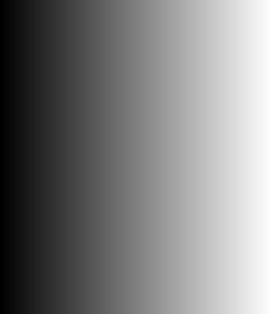

J'ai mis les valeurs de la hauteur et de la largeur comme arguments de la fonction pour que l'utilisateur puisse choisir la taille de l'image qu'il veut obtenir. Pour cela, j'ai inclus dans ma fonction main() la demande de ces valeurs.
Je les ai minoré par 100 pour avoir une taille d'image qui n'est pas trop petite.

## Difficulté 2 ⭐⭐

### Exercice 1 — Miroir

| Image originale | Image miroir |
|:---:|:---:|
|  |  |

Il faut faire attention à parcourir uniquement la moitié de l'image car sinon il y aura 2 fois l'échange de pixels et donc l'image sera identique à l'originale.

### Exercice 2 — Image bruitée

| Image originale | Image bruitée |
|:---:|:---:|
|  | 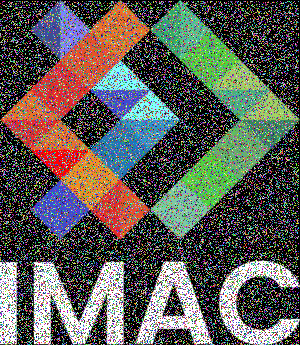 |

L'entier nb_pixels_bruit n'est pas le nombre précis de pixels différents mais le nombre de fois où on associe une valeur aléatoire à un pixel. Donc, le même pixel peut-être modifié plusieurs fois. On prend une valeur entre 1000 et max_nb_effet*1000 pour que l'effet soit très visible car la valeur de max_nb_effet est assez petite puisqu'elle sert dans d'autres fonctions qui le nécessitent.

Il faut faire attention aux bornes des fonctions random_int et random_float car le maximum est exclu.
    

### Exercice 3 — Rotation à 90° et à 270°

| Image originale | Rotation à 90° | Rotation à 270° |
|:---:|:---:|:---:|
|  |  | 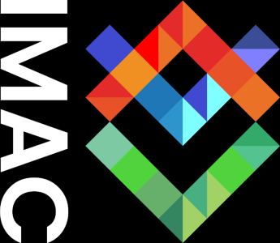 |

Il faut faire attention aux dimensions de la nouvelle image crée qui sont l'inverse de l'image originale.

### Exercice 4 — RGB split

| Image originale | RGB split |
|:---:|:---:|
|  | 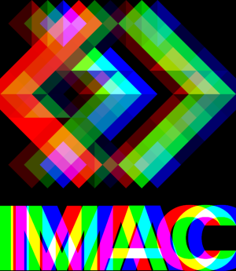 |

J'ai mis la valeur du décalage des couleurs comme argument de la fonction pour que l'utilisateur puisse choisir le décalage qu'il souhaite. Pour cela, j'ai inclus dans ma fonction main() la demande de cette valeur.

### Exercice 5 — Luminosité

| Image originale | Image éclaircie | Image assombrie |
|:---:|:---:|:---:|
|  |  |  |

Pour éclaircir l'image, j'applique la racine carrée à chaque composante de couleur. Pour l'assombrir, j'élève chaque composante au carré. Cela permet de modifier l'intensité des couleurs tout en conservant leurs proportions.

### Exercice 6 — Disque

J'ai mis les valeurs de la hauteur et de la largeur comme arguments de la fonction pour que l'utilisateur puisse choisir la taille de l'image qu'il veut obtenir. Pour cela, j'ai inclus dans ma fonction main() la demande de ces valeurs.
Je les ai minoré par 100 pour avoir une taille d'image qui n'est pas trop petite.
J'ai mis la valeur du rayon comme argument de la fonction pour que l'utilisateur puisse le choisir. Pour cela, j'ai inclus dans ma fonction main() la demande de cette valeur.
Je ne majore pas le rayon et laisse donc la possibilité à l'utilisateur d'avoir un cercle qui prend toute l'image qui est alors entièrement blanche.

### Exercice 7 — Cercle

J'ai mis la valeur de la hauteur et de la largeur comme arguments de la fonction pour que l'utilisateur puisse choisir la taille de l'image qu'il veut obtenir. Pour cela, j'ai inclus dans ma fonction main() la demande de ces valeurs.
Je les ai minoré par 100 pour avoir une taille d'image qui n'est pas trop petite.
J'ai mis les valeurs du rayon et de l'épaisseur comme arguments de la fonction pour que l'utilisateur puisse les choisir. Pour cela, j'ai inclus dans ma fonction main() la demande de ces valeurs.
Je ne majore pas le rayon et laisse donc la possibilité à l'utilisateur d'avoir un cercle qui prend toute l'image qui est alors entièrement blanche.

### Exercice 8 — Animation

J'ai mis la valeur de la hauteur et de la largeur comme arguments de la fonction pour que l'utilisateur puisse choisir la taille de l'image qu'il veut obtenir. Pour cela, j'ai inclus dans ma fonction main() la demande de ces valeurs.
Je les ai minoré par 100 pour avoir une taille d'image qui n'est pas trop petite.
J'ai appris comment il faut faire pour sauvegarder toutes les images une à une dans une boucle.

## Difficulté 3 ⭐⭐⭐

### Exercice 1 — Rosace

J'ai mis la valeur de la hauteur et de la largeur comme arguments de la fonction pour que l'utilisateur puisse choisir la taille de l'image qu'il veut obtenir. Pour cela, j'ai inclus dans ma fonction main() la demande de ces valeurs.
Je les ai minoré par 100 pour avoir une taille d'image qui n'est pas trop petite.
J'ai mis les valeurs du rayon et de l'épaisseur comme arguments de la fonction pour que l'utilisateur puisse les choisir. Pour cela, j'ai inclus dans ma fonction main() la demande de ces valeurs.
Je ne majore pas le rayon et laisse donc la possibilité à l'utilisateur d'avoir un cercle qui prend toute l'image qui est alors entièrement blanche.
Il faut faire attention à l'unité des angles qui doivent être exprimés en radians.

### Exercice 2 — Mosaïque

| Image originale | Mosaïque |
|:---:|:---:|
|  |  |

J'ai mis les valeurs du nombre d'images en largeur et en hauteur comme arguments de la fonction pour que l'utilisateur puisse les choisir. Pour cela, j'ai inclus dans ma fonction main() la demande de ces valeurs.
Il faut faire attention aux dimensions de la nouvelle image crée qui dépendent du nombre d'image en largeur et en hauteur.

### Exercice 3 — Mosaïque miroir

| Image originale | Mosaïque miroir |
|:---:|:---:|
|  | 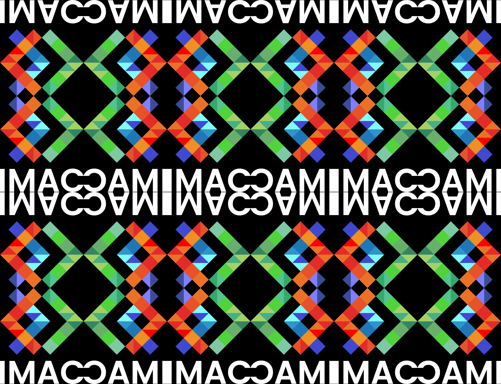 |

### Exercice 4 — Glitch

| Image originale | Glitch |
|:---:|:---:|
|  |  |

La valeur max_nb_effet choisie par l'utilisateur est relativement petite afin que l'image reste lisible malgré l'effet.
De même, j'ai borné les valeurs de largeur et hauteur des effets du glitch par celles de l'image divisées par 10 pour que la zone transformée ne soit pas trop grande et ainsi que l'image reste lisible.
Il faut vérifier que les coordonnées calculées restent dans les limites de l'image pour éviter d'accéder à des pixels inexistants.

### Exercice 5 — Tri des pixels

**Tri de tous les pixels par luminosité croissante :**

| Image originale | Image triée |
|:---:|:---:|
|  |  |

**Tri des pixels de chaque colonne selon les valeurs croissantes de rouge :**

| Image originale | Image triée |
|:---:|:---:|
|  | 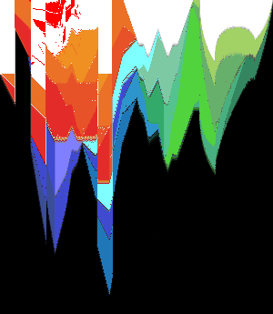 |

**Tri des pixels de chaque ligne selon les valeurs croissantes de bleu :**

| Image originale | Image triée |
|:---:|:---:|
|  | 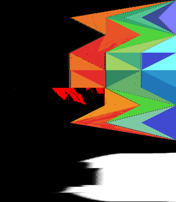 |

**Tri aléatoire de pixels sur les lignes selon les valeurs décroissantes de vert :**

| Image originale | Image triée |
|:---:|:---:|
|  |  |

J'ai limité la valeur de largeur de la zone à trier par celle de l'image divisée par 10 -1 pour que la zone transformée ne soit pas trop grande et ainsi que l'image reste lisible.

## Difficulté 4 ⭐⭐⭐⭐

### Exercice 1 — Fractale de Mandelbrot

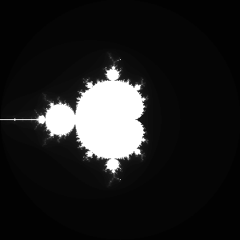

J'ai mis les valeurs de la hauteur et de la largeur comme arguments de la fonction pour que l'utilisateur puisse choisir la taille de l'image qu'il veut obtenir. Pour cela, j'ai inclus dans ma fonction main() la demande de ces valeurs.
Je les ai minoré par 100 pour avoir une taille d'image qui n'est pas trop petite.
Je limite le nombre d'itérations à 100 pour éviter une boucle infinie. 
La couleur dépend du nombre d'itérations effectuées avant que le point ne dépasse cette limite.

### Exercice 2 — Dégradés de couleurs : sRGB et Oklab

| Dégradé sRGB | Dégradé Oklab |
|:---:|:---:|
| 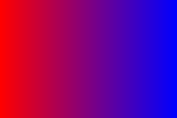 |  |

J'ai mis les valeurs de la hauteur et de la largeur comme arguments des fonctions pour que l'utilisateur puisse choisir la taille de l'image qu'il veut obtenir. Pour cela, j'ai inclus dans ma fonction main() la demande de ces valeurs.
Je les ai minoré par 100 pour avoir une taille d'image qui n'est pas trop petite.
Pour simplifier les écritures et bien différencier l'espace de couleur dans lequel je travaille j'ai définie les structures Lab et LinearRGB.

### Exercice 3 — Ordered dithering

| Image originale | Ordered dithering |
|:---:|:---:|
|  |  |

J'utilise une matrice de Bayer de taille 4 × 4 (trouvée sur internet) pour faire varier le seuil de conversion selon la position du pixel. 
L'opérateur modulo me permet de répéter la matrice sur toute l'image.

### Exercice 4 — Normalisation de l'histogramme

| Image originale | Normalisation de l'histogramme |
|:---:|:---:|
|  |  |

Après avoir trouvée les valeurs minimale et maximale de luminosité de l'image, j'étire la luminosité entre 0 et 1 pour que la luminosité la plus faible corresponde à 0 et la plus élevée à 1. Pour conserver les proportions entre les composantes rouge, verte et bleue, j'applique le même facteur de mise à l'échelle aux trois canaux d'un pixel.
Il faut faire attention aux divisions par zéro, notamment si toutes les luminosités sont identiques ou si la luminosité du pixel vaut zéro.

### Exercice 5 — Vortex

| Image originale | Vortex |
|:---:|:---:|
|  | 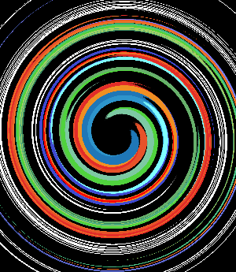 |

L'angle de rotation dépend de la distance du pixel au centre de l'image. Plus un pixel est éloigné du centre, plus sa rotation est importante. 
Pour chaque pixel de la nouvelle image, je calcule son angle de rotation et je cherche quel est son point source dans l'image originale.
Il faut vérifier que le pixel source se trouve bien dans l'image.
J'ai mis la valeur de l'angle maximal comme argument de la fonction pour que l'utilisateur puisse choisir la rotation maximale qu'il souhaite. Pour cela, j'ai inclus dans ma fonction main() la demande de cette valeur.

### Exercice 6 — Convolutions

**Images originales :**

| Logo | Photo |
|:---:|:---:|
|  |  |

**Résultats des convolutions :**

| Flou | Outline | Emboss | Sharpen |
|:---:|:---:|:---:|:---:|
|  |  |  |  |

| Top Sobel | Bottom Sobel | Left Sobel | Right Sobel |
|:---:|:---:|:---:|:---:|
| 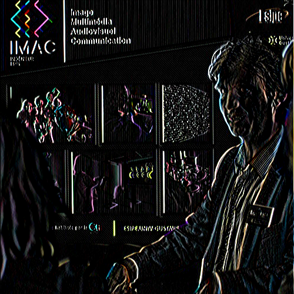 |  | 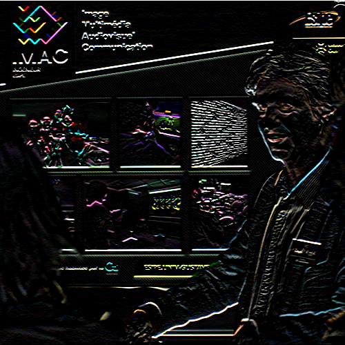 |  |

J'ai trouvé une formule de convolution pour les kernel de taille 3 x 3 qui me permet d'appliquer les différents effets à partir de leur matrice (définie dans la fonction main()).
J'ai également trouvé une formule plus générale pour l'effet de flou qui permet à l'utilisateur de choisir la taille du kernel afin d'avoir une image plus ou moins floue.
J'impose à la taille du kernel d'être impaire pour avoir un pixel central.
Il faut faire attention à bien gérer les pixels situés sur les bords de l'image, car ils n'ont pas tous leurs voisins.

| Image originale | Différence de flou |
|:---:|:---:|
|  | 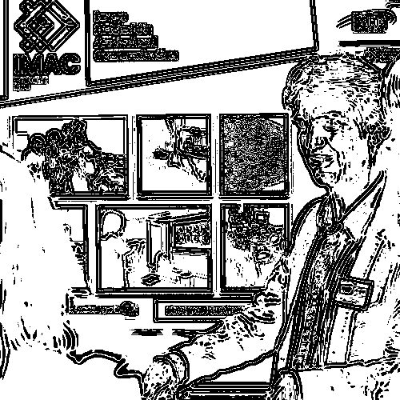 |

L'algorithme sert à faire une différence de deux mêmes images mais avec un flou plus ou moins prononcé afin d'obtenir une image en noir et blanc faisant ressortir les contours. 
J'ai mis les valeurs de la taille du kernel et de la différence entre les deux tailles de kernel comme arguments de la fonction pour que l'utilisateur puisse choisir l'effet qu'il veut. Pour cela, j'ai inclus dans ma fonction main() la demande de ces valeurs.
J'impose à la taille des kernels d'être impaire (et donc à la différence d'être paire) pour avoir un pixel central.Cependant, j'impose le seuil à 0.01 pour que les contours apparaissent mais sans être très larges.