# Rapport Workshop de programmation S1 - Ethel Douzals


## Difficulté 1 ⭐


### Exercice 1 — Ne garder que le vert

| Image originale | Image avec uniquement le vert |
|:---:|:---:|
|  |  |


### Exercice 2 — Échanger les canaux

| Image originale | Image après l'échange des canaux vert et bleu |
|:---:|:---:|
|  |  |


### Exercice 3 — Noir et blanc

| Image originale | Image en nuances de gris |
|:---:|:---:|
|  |  |


### Exercice 4 — Négatif

| Image originale | Négatif |
|:---:|:---:|
|  |  |


### Exercice 5 — Dégradé


```cpp
void degrade(int const largeur, int const hauteur);
  ```
<details>
  <summary>Arguments de la fonction</summary>
  <p>J'ai mis les valeurs de la hauteur et de la largeur comme arguments de la fonction pour que l'utilisateur puisse choisir la taille de l'image qu'il veut obtenir. Pour cela, j'ai inclus dans ma fonction main() la demande de ces valeurs.
  Je les ai minorés par 100 pour avoir une taille d'image qui n'est pas trop petite.</p>
</details>

 


## Difficulté 2 ⭐⭐


### Exercice 1 — Miroir

| Image originale | Image miroir |
|:---:|:---:|
|  |  |

Il faut faire attention à parcourir uniquement la moitié de l'image car sinon il y aura 2 fois l'échange de pixels et donc l'image sera identique à l'originale.


### Exercice 2 — Image bruitée

| Image originale | Image bruitée |
|:---:|:---:|
|  |  |

L'entier nb_pixels_bruit n'est pas le nombre précis de pixels différents mais le nombre de fois où on associe une valeur aléatoire à un pixel. Donc, le même pixel peut-être modifié plusieurs fois. On prend une valeur entre 1000 et max_nb_effet*1000 pour que l'effet soit très visible car la valeur de max_nb_effet est assez petite puisqu'elle sert dans d'autres fonctions qui le nécessitent.

Il faut faire attention aux bornes des fonctions random_int et random_float car le maximum est exclu.

```cpp
void image_bruitee(sil::Image& image, int const max_nb_effet);
  ```
<details>
  <summary>Arguments de la fonction</summary>
  <p>J'ai mis la valeur du nombre maximal d'effet comme argument de la fonction pour que l'utilisateur puisse le choisir. Cela permet de majorer le nombre de modifications des pixels. Pour cela, j'ai inclus dans ma fonction main() la demande de cette valeur. 
  Sa valeur est assez petite puisqu'elle sert dans d'autres fonctions qui le nécessitent.
  </p>
</details>
    

### Exercice 3 — Rotation à 90° et à 270°

| Image originale | Rotation à 90° | Rotation à 270° |
|:---:|:---:|:---:|
|  |  |  |

Il faut faire attention aux dimensions de la nouvelle image crée qui sont l'inverse de l'image originale.


### Exercice 4 — RGB split

| Image originale | RGB split |
|:---:|:---:|
|  |  |


```cpp
void rgb_split(sil::Image& image, int decalage);
  ```
<details>
  <summary>Arguments de la fonction</summary>
  <p>J'ai mis la valeur du décalage des couleurs comme argument de la fonction pour que l'utilisateur puisse choisir le décalage qu'il souhaite. Pour cela, j'ai inclus dans ma fonction main() la demande de cette valeur.
  </p>
</details>

### Exercice 5 — Luminosité

| Image originale | Image éclaircie | Image assombrie |
|:---:|:---:|:---:|
|  |  |  |

Pour éclaircir l'image, j'applique la racine carrée à chaque composante de couleur. Pour l'assombrir, j'élève chaque composante au carré. Cela permet de modifier l'intensité des couleurs tout en conservant leurs proportions.


### Exercice 6 — Disque


```cpp
void disque(int const largeur, int const hauteur, int const rayon);
  ```
<details>
  <summary>Arguments de la fonction</summary>
  <p>
  J'ai mis les valeurs de la hauteur et de la largeur comme arguments de la fonction pour que l'utilisateur puisse choisir la taille de l'image qu'il veut obtenir. Pour cela, j'ai inclus dans ma fonction main() la demande de ces valeurs.
  Je les ai minorés par 100 pour avoir une taille d'image qui n'est pas trop petite.
  J'ai mis la valeur du rayon comme argument de la fonction pour que l'utilisateur puisse le choisir. Pour cela, j'ai inclus dans ma fonction main() la demande de cette valeur.
  Je ne majore pas le rayon et laisse donc la possibilité à l'utilisateur d'avoir un cercle qui prend toute l'image qui est alors entièrement blanche.
  </p>
</details>


### Exercice 7 — Cercle

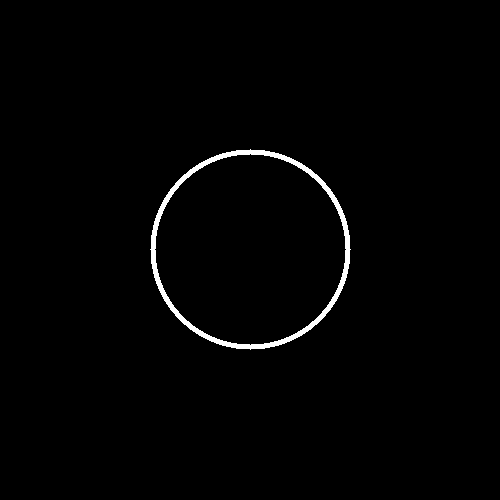

```cpp
void cercle(int const largeur, int const hauteur, int const rayon, int const epaisseur);
  ```
<details>
  <summary>Arguments de la fonction</summary>
  <p>
  J'ai mis la valeur de la hauteur et de la largeur comme arguments de la fonction pour que l'utilisateur puisse choisir la taille de l'image qu'il veut obtenir. Pour cela, j'ai inclus dans ma fonction main() la demande de ces valeurs.
  Je les ai minorés par 100 pour avoir une taille d'image qui n'est pas trop petite.
  J'ai mis les valeurs du rayon et de l'épaisseur comme arguments de la fonction pour que l'utilisateur puisse les choisir. Pour cela, j'ai inclus dans ma fonction main() la demande de ces valeurs.
  Je ne majore pas le rayon et laisse donc la possibilité à l'utilisateur d'avoir un cercle qui prend toute l'image qui est alors entièrement blanche.
  </p>
</details>


### Exercice 8 — Animation

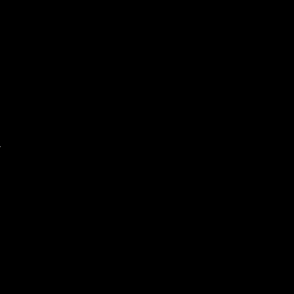

Grâce à cette fonction j'ai appris comment il fallait faire pour sauvegarder toutes les images une à une dans une boucle.

```cpp
void animation_disques(int const largeur, int const hauteur, int rayon);
  ```
<details>
  <summary>Arguments de la fonction</summary>
  <p>
  J'ai mis les valeurs de la hauteur et de la largeur comme arguments de la fonction pour que l'utilisateur puisse choisir la taille de l'image qu'il veut obtenir. Pour cela, j'ai inclus dans ma fonction main() la demande de ces valeurs.
  Je les ai minorés par 100 pour avoir une taille d'image qui n'est pas trop petite.
  J'ai mis la valeur du rayon comme argument de la fonction pour que l'utilisateur puisse le choisir. Pour cela, j'ai inclus dans ma fonction main() la demande de cette valeur.
  Je ne majore pas le rayon et laisse donc la possibilité à l'utilisateur d'avoir un cercle qui prend toute l'image qui est alors entièrement blanche.
  </p>
</details>


## Difficulté 3 ⭐⭐⭐


### Exercice 1 — Rosace

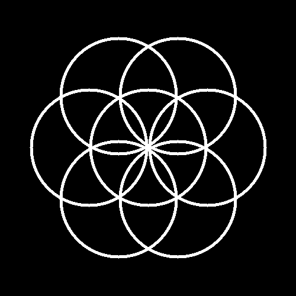

Il faut faire attention à l'unité des angles qui doivent être exprimés en radians.

```cpp
void rosace (int const largeur, int const hauteur, int const rayon, int const epaisseur);
  ```
<details>
  <summary>Arguments de la fonction</summary>
  <p>
  J'ai mis la valeur de la hauteur et de la largeur comme arguments de la fonction pour que l'utilisateur puisse choisir la taille de l'image qu'il veut obtenir. Pour cela, j'ai inclus dans ma fonction main() la demande de ces valeurs.
  Je les ai minorés par 100 pour avoir une taille d'image qui n'est pas trop petite.
  J'ai mis les valeurs du rayon et de l'épaisseur comme arguments de la fonction pour que l'utilisateur puisse les choisir. Pour cela, j'ai inclus dans ma fonction main() la demande de ces valeurs.
  Je ne majore pas le rayon et laisse donc la possibilité à l'utilisateur d'avoir un cercle qui prend toute l'image qui est alors entièrement blanche.
  </p>
</details>


### Exercice 2 — Mosaïque

| Image originale | Mosaïque |
|:---:|:---:|
|  | 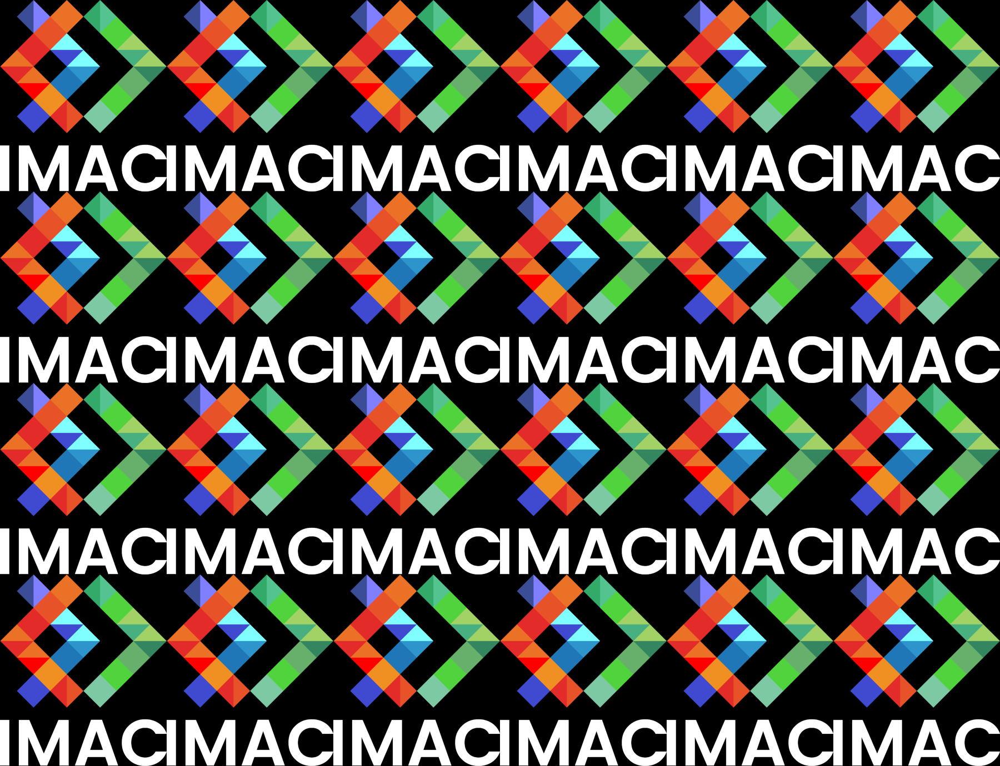 |

Il faut faire attention aux dimensions de la nouvelle image crée qui dépendent du nombre d'images en largeur et en hauteur.

```cpp
void mosaique (int const nb_largeur, int const nb_hauteur, sil::Image const& image);
  ```
<details>
  <summary>Arguments de la fonction</summary>
  <p>
  J'ai mis les valeurs du nombre d'images en largeur et en hauteur comme arguments de la fonction pour que l'utilisateur puisse les choisir. Pour cela, j'ai inclus dans ma fonction main() la demande de ces valeurs.
  </p>
</details>


### Exercice 3 — Mosaïque miroir

| Image originale | Mosaïque miroir |
|:---:|:---:|
|  |  |

Il faut faire attention aux dimensions de la nouvelle image crée qui dépendent du nombre d'images en largeur et en hauteur.

```cpp
void mosaique_miroir (int const nb_largeur, int const nb_hauteur, sil::Image const& image);
  ```
<details>
  <summary>Arguments de la fonction</summary>
  <p>
  J'ai mis les valeurs du nombre d'images en largeur et en hauteur comme arguments de la fonction pour que l'utilisateur puisse les choisir. Pour cela, j'ai inclus dans ma fonction main() la demande de ces valeurs.
  </p>
</details>


### Exercice 4 — Glitch

| Image originale | Glitch |
|:---:|:---:|
|  | 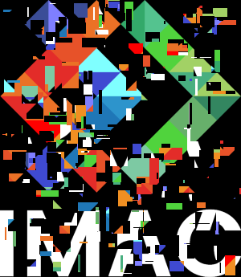 |

J'ai borné les valeurs de largeur et hauteur des effets du glitch par celles de l'image divisées par 10 pour que la zone transformée ne soit pas trop grande et ainsi que l'image reste lisible.
Il faut vérifier que les coordonnées calculées restent dans les limites de l'image pour éviter d'accéder à des pixels inexistants.

```cpp
void glitch(sil::Image& image, int const max_nb_effet);
  ```
<details>
  <summary>Arguments de la fonction</summary>
  <p>
  La valeur max_nb_effet choisie par l'utilisateur est relativement petite afin que l'image reste lisible malgré l'effet.
  </p>
</details>


### Exercice 5 — Tri des pixels

**Tri de tous les pixels par luminosité croissante :**

| Image originale | Image triée |
|:---:|:---:|
|  |  |


**Tri des pixels de chaque colonne selon les valeurs croissantes de rouge :**

| Image originale | Image triée |
|:---:|:---:|
|  |  |


**Tri des pixels de chaque ligne selon les valeurs croissantes de bleu :**

| Image originale | Image triée |
|:---:|:---:|
|  |  |


**Tri aléatoire de pixels sur les lignes selon les valeurs décroissantes de vert :**

| Image originale | Image triée |
|:---:|:---:|
|  |  |

L'entier nb_tri n'est pas le nombre précis de zones à modifier mais le nombre de fois où on change des zones. Donc, la même zone (ou partie d'une zone) peut-être modifiée plusieurs fois. On prend une valeur entre 100 et max_nb_effet*100 pour que l'effet soit très visible car la valeur de max_nb_effet est assez petite.

J'ai limité la valeur de largeur de la zone à trier par celle de l'image divisée par 10 -1 pour que la zone transformée ne soit pas trop grande et ainsi que l'image reste lisible.

Il faut faire attention aux bornes des fonctions random_int et random_float car le maximum est exclu.

```cpp
void tri_pixels_aleatoire_ligne_vert_dec(sil::Image& image, int const max_nb_effet);
  ```
<details>
  <summary>Arguments de la fonction</summary>
  <p>J'ai mis la valeur du nombre maximal d'effet comme argument de la fonction pour que l'utilisateur puisse le choisir. Cela permet de majorer le nombre de modifications des pixels. Pour cela, j'ai inclus dans ma fonction main() la demande de cette valeur. 
  Sa valeur est assez petite puisqu'elle sert dans d'autres fonctions qui le nécessitent.
  </p>
</details>


## Difficulté 4 ⭐⭐⭐⭐


### Exercice 1 — Fractale de Mandelbrot


Je limite le nombre d'itérations à 100 pour éviter une boucle infinie. 
La couleur dépend du nombre d'itérations effectuées avant que le point ne dépasse cette limite.

```cpp
void fractale_Mandelbrot(int const largeur, int const hauteur);
  ```
<details>
  <summary>Arguments de la fonction</summary>
  <p>J'ai mis les valeurs de la hauteur et de la largeur comme arguments de la fonction pour que l'utilisateur puisse choisir la taille de l'image qu'il veut obtenir. Pour cela, j'ai inclus dans ma fonction main() la demande de ces valeurs.
  Je les ai minorés par 100 pour avoir une taille d'image qui n'est pas trop petite.
  </p>
</details>


### Exercice 2 — Dégradés de couleurs : sRGB et Oklab

| Dégradé sRGB | Dégradé Oklab |
|:---:|:---:|
|  | 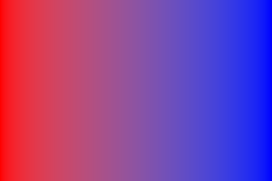 |

```cpp
struct Lab {float L; float a; float b;};
struct LinearRGB {float r; float g; float b;};
  ```
Pour simplifier les écritures et bien différencier l'espace de couleur dans lequel je travaille j'ai définie les structures Lab et LinearRGB.

```cpp
void degrade_mix_rb(int const largeur, int const hauteur);
void degrade_oklab_rb(int const largeur, int const hauteur);
  ```
<details>
  <summary>Arguments de la fonction</summary>
  <p>J'ai mis les valeurs de la hauteur et de la largeur comme arguments des fonctions pour que l'utilisateur puisse choisir la taille de l'image qu'il veut obtenir. Pour cela, j'ai inclus dans ma fonction main() la demande de ces valeurs.
  Je les ai minorés par 100 pour avoir une taille d'image qui n'est pas trop petite.
  </p>
</details>

### Exercice 3 — Ordered dithering

| Image originale | Ordered dithering |
|:---:|:---:|
|  |  |

J'utilise une matrice de Bayer de taille 4 × 4 (trouvée sur internet) pour faire varier le seuil de conversion selon la position du pixel. 
L'opérateur modulo me permet de répéter la matrice sur toute l'image.


### Exercice 4 — Normalisation de l'histogramme

| Image originale | Normalisation de l'histogramme |
|:---:|:---:|
|  |  |

Après avoir trouvée les valeurs minimale et maximale de luminosité de l'image, j'étire la luminosité entre 0 et 1 pour que la luminosité la plus faible corresponde à 0 et la plus élevée à 1. Pour conserver les proportions entre les composantes rouge, verte et bleue, j'applique le même facteur de mise à l'échelle aux trois canaux d'un pixel.
Il faut faire attention aux divisions par zéro, notamment si toutes les luminosités sont identiques ou si la luminosité du pixel vaut zéro.


### Exercice 5 — Vortex

| Image originale | Vortex |
|:---:|:---:|
|  |  |

L'angle de rotation dépend de la distance du pixel au centre de l'image. Plus un pixel est éloigné du centre, plus sa rotation est importante. 
Pour chaque pixel de la nouvelle image, je calcule son angle de rotation et je cherche quel est son point source dans l'image originale.
Il faut vérifier que le pixel source se trouve bien dans l'image.

```cpp
glm::vec2 rotated(glm::vec2 point, glm::vec2 center_of_rotation, float angle);
  ```
<details>
  <summary>Arguments de la fonction</summary>
  <p>J'ai mis la valeur de l'angle maximal comme argument de la fonction pour que l'utilisateur puisse choisir la rotation maximale qu'il souhaite. Pour cela, j'ai inclus dans ma fonction main() la demande de cette valeur.
  </p>
</details>


### Exercice 6 — Convolutions

**Images originales :**

| Logo | Photo |
|:---:|:---:|
|  |  |

**Résultats des convolutions :**

| Flou | Outline | Emboss | Sharpen |
|:---:|:---:|:---:|:---:|
|  |  |  |  |

| Top Sobel | Bottom Sobel | Left Sobel | Right Sobel |
|:---:|:---:|:---:|:---:|
|  | 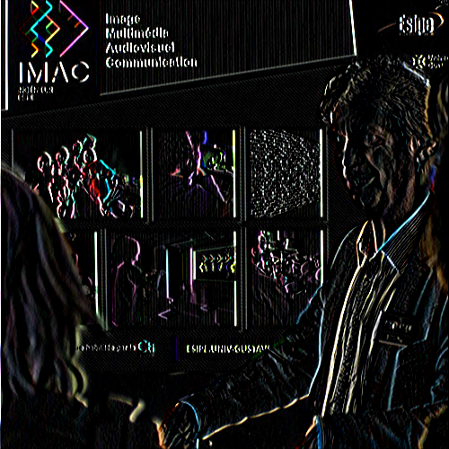 |  | 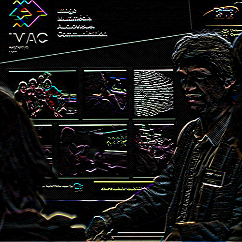 |

J'ai trouvé une formule de convolution pour les kernel de taille 3 x 3 qui me permet d'appliquer les différents effets à partir de leur matrice (définie dans la fonction main()).

Il faut faire attention à bien gérer les pixels situés sur les bords de l'image, car ils n'ont pas tous leurs voisins.

J'ai également trouvé une formule plus générale pour l'effet de flou qui permet à l'utilisateur de choisir la taille du kernel afin d'avoir une image plus ou moins floue.


```cpp
void flou_generalise (sil::Image& image, int const taille_kernel);
  ```
<details>
  <summary>Arguments de la fonction</summary>
  <p>J'ai mis la taille du kernel (carré) comme argument de la fonction pour que l'utilisateur puisse avoir une image plus ou moins floue. Pour cela, j'ai inclus dans ma fonction main() la demande de cette valeur.
  J'impose à la taille du kernel d'être impaire pour avoir un pixel central.
  </p>
</details>


| Image originale | Différence de flou |
|:---:|:---:|
|  |  |

L'algorithme sert à faire une différence de deux mêmes images mais avec un flou plus ou moins prononcé afin d'obtenir une image en noir et blanc faisant ressortir les contours. 
J'impose le seuil à 0.01 pour que les contours apparaissent mais sans être très larges.

```cpp
void diff_flou (sil::Image& image, int const taille_kernel, int const diff_kernel);
  ```
<details>
  <summary>Arguments de la fonction</summary>
  <p>J'ai mis les valeurs de la taille du kernel et de la différence entre les deux tailles de kernel comme arguments de la fonction pour que l'utilisateur puisse choisir l'effet qu'il veut. Pour cela, j'ai inclus dans ma fonction main() la demande de ces valeurs.
  J'impose à la taille des kernels d'être impaire (et donc à la différence d'être paire) pour avoir un pixel central. 
  </p>
</details>


## Mes exercices

En complément des exercices proposés, j'ai réalisé plusieurs effets personnels qui m'intéressaient afin d'explorer différentes transformations d'images et techniques de traitement des pixels. Pour m'aider, me suis basée sur la description des algorithmes derrière ces effets.
Pour simplifier, je n'ai pas rajouté d'arguments au choix pour l'utilisateur.
Egalement, j'ai simplifié l'expression de la luminosité en faisant uniquement la moyenne des valeurs des 3 canaux.


### Exercice 1 — Effet fisheye

| Image originale | Effet fisheye |
|:---:|:---:|
|  | 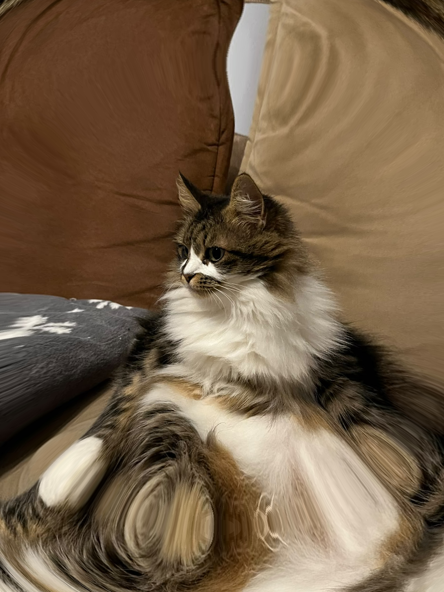 |


Cet effet déforme l'image pour donner une impression de bombement, comme si elle était observée à travers une lentille grand-angle. La déformation dépend de la distance entre chaque pixel et le centre de l'image : plus un pixel est éloigné du centre, plus ses coordonnées sources sont rapprochées de celui-ci.


### Exercice 2 — Ondulations

| Image originale | Ondulations |
|:---:|:---:|
|  | 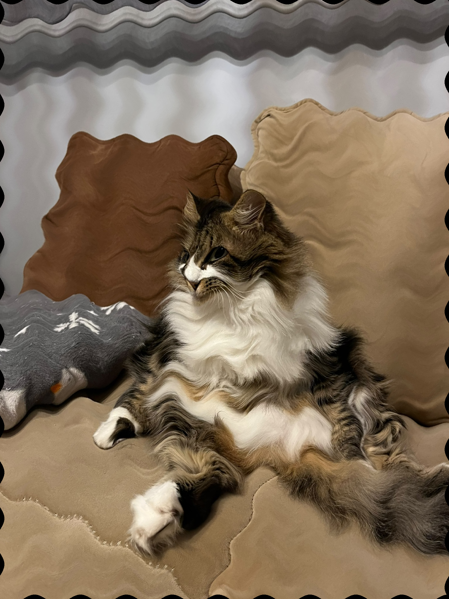 |

Cet effet déforme l'image en décalant les pixels horizontalement et verticalement selon des fonctions sinusoïdales. L'amplitude et la fréquence des sinus permettent de contrôler l'intensité et l'espacement des ondulations.
J'ai défini la taille de la nouvelle image comme celle de l'image originale mais j'ai donc des zones noires sur les bords décalés. Pour y remédier, j'avais donc rajouté une partie dans ma fonction pour zoomer un peu dans l'image pour ne plus voir ces zones mais cela coupait une partie de l'image donc j'ai préféré enlever cette partie et garder les zones noires des bords. Je ne savais pas faire autrement pour enlever ces zones noires qu'en zoomant.


### Exercice 3 — Peinture à l'huile

| Image originale | Peinture à l'huile |
|:---:|:---:|
|  |  |

Cet effet donne à l'image un aspect de peinture à l'huile. Pour chaque pixel, les pixels voisins sont regroupés selon leur luminosité en plusieurs catégories. La couleur du groupe le plus représenté est ensuite utilisée pour remplacer le pixel d'origine, ce qui crée des zones de couleurs plus uniformes.


### Exercice 4 — Pointillisme

| Image originale | Poitillisme |
|:---:|:---:|
|  | 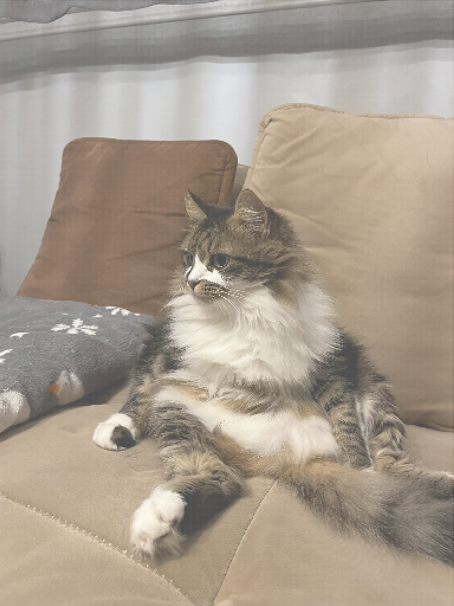 |

Cet effet s'inspire de la technique du pointillisme, qui consiste à composer une image à partir de petits points de couleur. L'image est d'abord remplie de blanc, puis des cercles sont dessinés à intervalles réguliers. Chaque cercle reprend la couleur du pixel correspondant dans l'image originale.
Selon la valeur du rayon et de l'espacement, l'image paraît plus ou moins claire dûe au fond blanc des espaces entre les points.


### Exercice 5 — Hachures

| Image originale | Hachures |
|:---:|:---:|
|  | 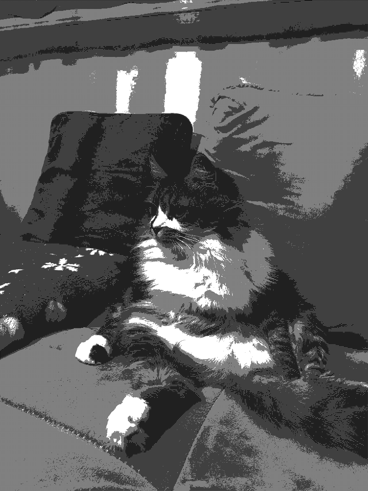 |

J'ai trouvé cette idée en me renseignant sur l'ordered dithering donc j'ai eu envie de la réaliser.
Cet effet transforme l'image en dessin noir et blanc à l'aide de motifs de lignes. La luminosité de chaque pixel détermine les hachures appliquées : les zones sombres reçoivent plusieurs directions de traits, tandis que les zones claires restent principalement blanches.


### Exercice 6 — Low Poly

| Image originale | Low Poly |
|:---:|:---:|
|  | 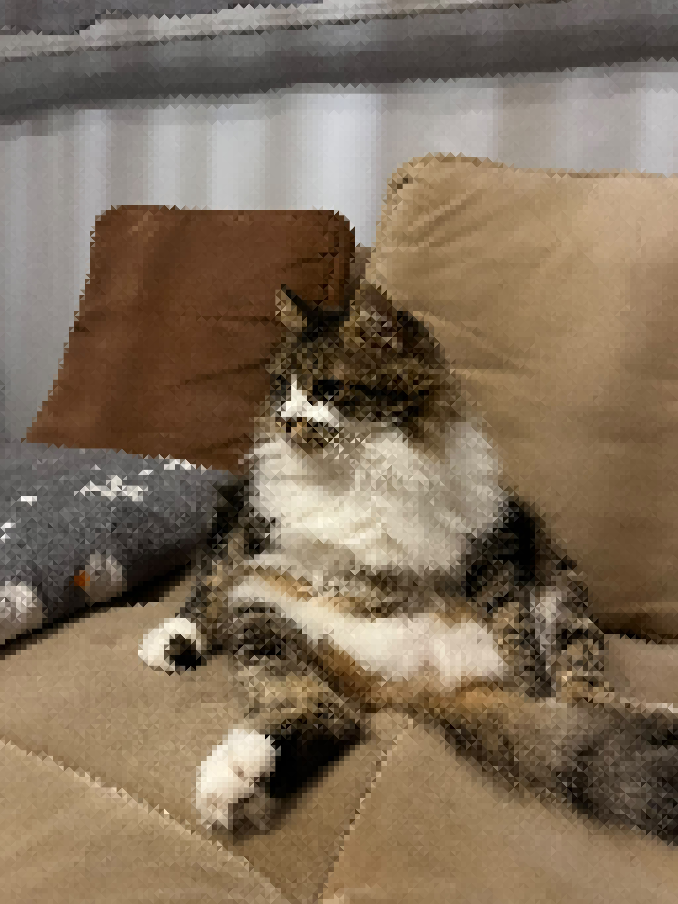 |

Cet effet simplifie l'image en la découpant en triangles. Chaque triangle est rempli avec une couleur prélevée dans l'image originale, à proximité de son centre. L'ensemble forme une mosaïque géométrique qui conserve les principales couleurs et formes de l'image.
On peut distinguer plus ou moins les triangles selon la valeur choisie pour la taille des cellules de la grille.


### Exercice 7 — Néon

| Image originale | Néon bleu | Néon rose |
|:---:|:---:|:---:|
|  | 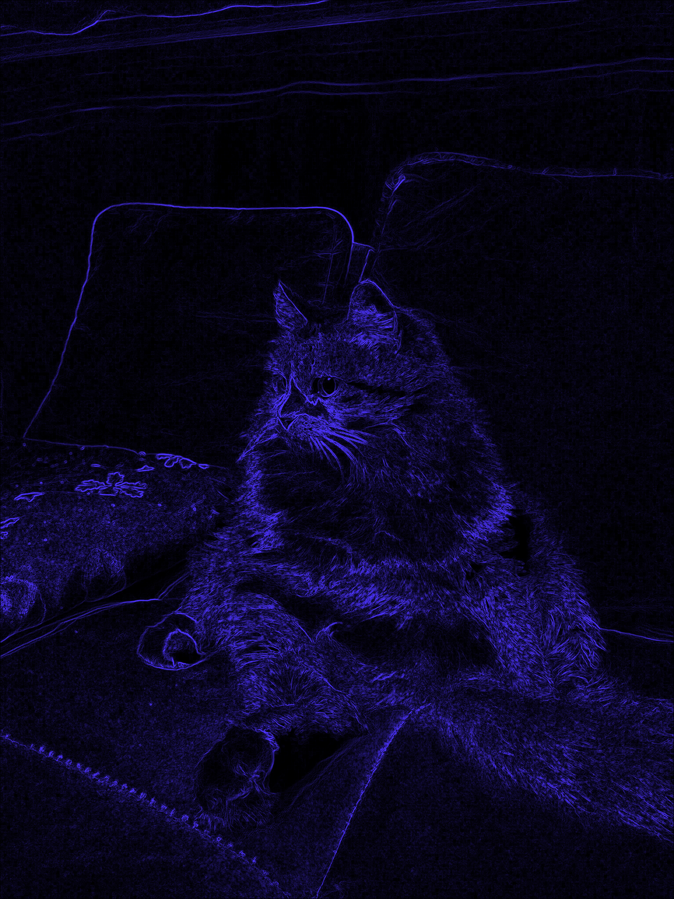 | 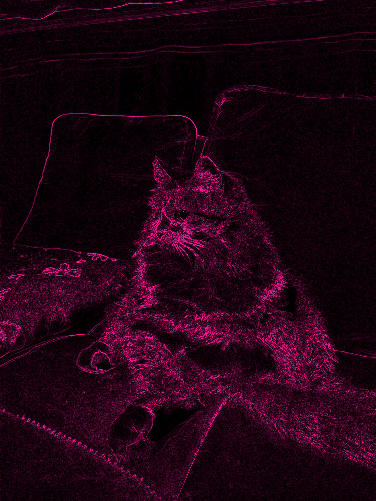 |

Cet effet détecte les contours de l'image en comparant la luminosité des pixels voisins horizontalement et verticalement. Les variations importantes indiquent les contours, qui sont ensuite colorés avec une couleur personnalisable sur un fond sombre. 

```cpp
void neon(sil::Image const& image, glm::vec3 const& couleur_neon);
  ```
<details>
  <summary>Arguments de la fonction</summary>
  <p>J'ai mis la couleur du néon comme argument de la fonction pour qu'on puisse la choisir. Pour cela, j'ai inclus dans ma fonction main() la définition de cette valeur.
  </p>
</details>


### Exercice 8 — Vision thermique

| Image originale | Vision thermique |
|:---:|:---:|
|  | 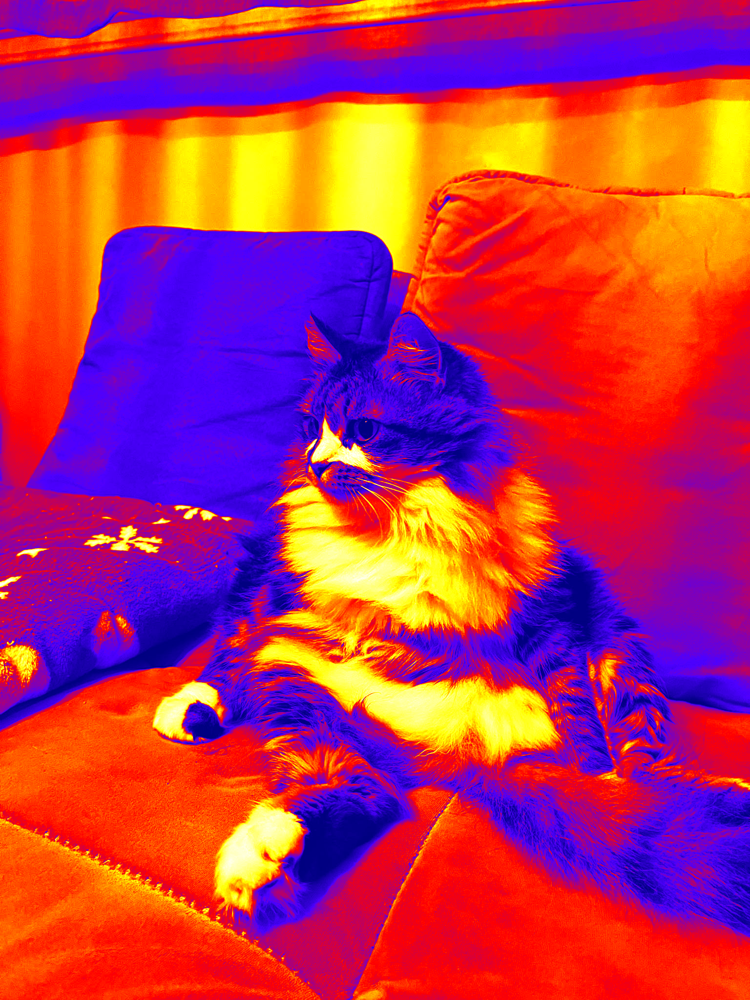 |

Cet effet transforme les couleurs de l'image en une palette inspirée des caméras thermiques. La luminosité de chaque pixel détermine sa nouvelle couleur : les zones sombres deviennent bleues ou violettes, les zones intermédiaires rouges ou jaunes, et les zones les plus lumineuses tendent vers le blanc.